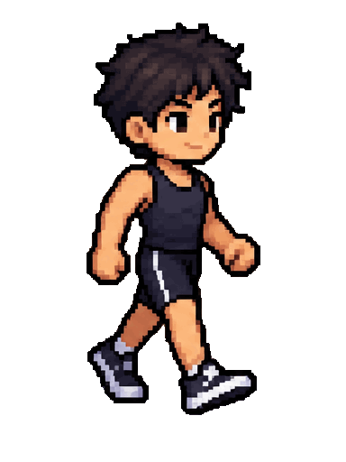

 

 

---

## 🧑‍🚀 PLAYER PROFILE

<table>
<tr>
<td width="190" align="center" valign="middle">

**PLAYER 001**  
`STOM`

</td>
<td valign="middle">

**Hi! I'm Sofyan Taurid Ode Madi**, but you can call me **STOM**.

🎓 Computer Engineering student at **Universitas Negeri Makassar** (Class of 2022).

💻 Interested in application development, web technologies, computer systems, and creative digital projects.

| PLAYER DATA | DETAILS |
|:--|:--|
| Field of Study | Teknik Komputer |
| University | Universitas Negeri Makassar |
| Interests | Technology, programming & social communities |
| Currently Learning | Application development |
| Hobbies | Graphic design, movies & cycling |
| Biggest Dream | Masuk Surga |

</td>
</tr>
</table>

---

## 🧰 INVENTORY / TECH SKILLS

**LANGUAGES & DEVELOPMENT**

  

**TOOLS & PLATFORMS**

---

## 🕹️ PROJECT ARCADE

*Choose a game card to enter the project repository.*

<table>
<tr>
<td width="33%" align="center" valign="top">

### 🥤 MINUM YUK

Aplikasi pengingat dan pencatatan konsumsi air minum untuk membantu pengguna memantau hidrasi harian.

</td>
<td width="33%" align="center" valign="top">

### 📞 JUSCANG

Aplikasi telepon yang dikembangkan sebagai proyek aplikasi komunikasi.

</td>
<td width="33%" align="center" valign="top">

### 💬 FORXUNM

Forum komunitas untuk berdiskusi dan berbagi informasi dengan fokus pada keamanan sistem tingkat tinggi.

</td>
</tr>
</table>

---

## 📟 GITHUB STATUS

 

---

## 🎒 SIDE QUESTS

<b>🎨 Open to discover STOM's fun facts</b>

 

- 🎬 Suka menonton film dari berbagai genre, kecuali horor.
- 🎨 Menyukai desain grafis dan proyek kreatif.
- 🚴 Gemar bersepeda.
- 💡 Sering punya ide kreatif, meskipun tidak semuanya langsung diwujudkan.

---

## 📡 CONNECT WITH ME

